# Закреп за фракталом → куда пойдёт цена · US30 Pepperstone H1 · пилот январь 2025

> **Пилот.** Задача — проверить, что правила поняты верно и отчёт читается. Выборка маленькая (сигналов: 52, торговых дней: 22), **выводы не делаем**.

- **Период:** 2025-01-02 — 2025-01-31 (время везде по Минску)
- **Данные:** график TradingView `PEPPERSTONE:US30`, 1 час; цели — H4 / D / W / M того же графика
- **Расчёт:** Pine-индикатор [`pine/zakrep-fractal.pine`](../../pine/zakrep-fractal.pine) (на графике — «BT: закреп за фракталом», layout `us30_backtest`); случаи взяты из Pine Logs ([`pine-logs.json`](pine-logs.json))
- **Правила:** [knowledge-base/US30.md](../../knowledge-base/US30.md#идея-1-закреп-за-фракталом--направление)

## Как читать

- **✅** — от закрытия свечи-сигнала цена первой дошла до ближайшей нетронутой зоны H4/D/W/M **по направлению** закрепа; **❌** — первой до ближайшей зоны **против**; **❓** — обе задеты одной часовой свечой (по H1 порядок не виден); **⏳** — за горизонт ни одной.
- **Горизонт:** сигналы Франкфурта и Лондона — **до конца Лондона** (разворот в США их не отменяет), сигнал США — до конца торгового дня.
- **% ✅** считается только из решённых (✅ + ❌).
- **База** — сколько процентов дала бы та же «гонка двух зон» без всякого сигнала: от закрытия каждой свечи тех же сессий, с тем же соотношением лонгов и шортов.
- **Случайное блуждание** — вторая, более строгая база: при случайном движении цены шанс первой дойти до цели по направлению равен «расстояние до цели против / сумма обоих расстояний». Она учитывает, что после закрепа ближняя цель по направлению обычно ближе. **Преимущество сетапа — это разница с обеими базами, прежде всего со второй.**

## Итог

| Сигнал | Случаев | ✅ | ❌ | ❓ | ⏳ | % ✅ | База | Разница | Случайное блуждание | Разница |
|---|---|---|---|---|---|---|---|---|---|---|
| Франкфурт | 9 | 3 | 1 | 0 | 5 | 75% | 50% | +25 п.п. | 76% | -1 п.п. |
| Лондон | 22 | 7 | 1 | 0 | 14 | 88% | 57% | +31 п.п. | 85% | +2 п.п. |
| США | 21 | 8 | 3 | 0 | 10 | 73% | 51% | +22 п.п. | 60% | +13 п.п. |
| **Первый сигнал дня** | 22 | 7 | 2 | 0 | 13 | 78% | 47% | +31 п.п. | 81% | -4 п.п. |
| **Все сигналы** | 52 | 18 | 5 | 0 | 29 | 78% | 53% | +26 п.п. | 72% | +7 п.п. |

### Лондон закрылся в сторону закрепа?

Закрытие последней свечи Лондона против закрытия свечи-сигнала. База — то же от закрытия каждой свечи сессии, без сигнала.

| Сигнал | Случаев | По направлению | Против | % | База | Разница | Средний ход, п. |
|---|---|---|---|---|---|---|---|
| Франкфурт | 9 | 3 | 6 | 33% | 59% | -26 п.п. | -67 |
| Лондон | 22 | 13 | 9 | 59% | 55% | +4 п.п. | -12 |

**Закреп удержан к концу Лондона** — последняя свеча Лондона закрылась за тем же уровнем фрактала:

- Франкфурт: 5 из 9
- Лондон: 16 из 22

### Срезы

| Срез | Случаев | ✅ | ❌ | ❓ | ⏳ | % ✅ | База | Разница | Случайное блуждание | Разница |
|---|---|---|---|---|---|---|---|---|---|---|
| Лонги | 36 | 12 | 2 | 0 | 22 | 86% | 64% | +21 п.п. | 74% | +12 п.п. |
| Шорты | 16 | 6 | 3 | 0 | 7 | 67% | 35% | +32 п.п. | 68% | -2 п.п. |
| Фрактал из сегодняшней Азии | 34 | 12 | 3 | 0 | 19 | 80% | 53% | +27 п.п. | 76% | +4 п.п. |
| Фрактал не из Азии | 18 | 6 | 2 | 0 | 10 | 75% | 52% | +23 п.п. | 63% | +12 п.п. |
| Всё тело за уровнем | 21 | 8 | 4 | 0 | 9 | 67% | 53% | +13 п.п. | 68% | -1 п.п. |
| За уровнем только закрытие | 31 | 10 | 1 | 0 | 20 | 91% | 52% | +39 п.п. | 75% | +16 п.п. |

### Базовая частота по сессиям

| Сессия | Свечей-точек | Вверх первым | Вниз первым | ❓ | ⏳ |
|---|---|---|---|---|---|
| Франкфурт | 22 | 8 (73%) | 3 (27%) | 0 | 11 |
| Лондон | 110 | 16 (76%) | 5 (24%) | 0 | 89 |
| США | 186 | 30 (54%) | 26 (46%) | 0 | 130 |

### Расстояние до целей в момент сигнала, пункты

| Сигнал | До цели по направлению | До цели против | Цель по направлению ближе |
|---|---|---|---|
| Франкфурт | 107 | 241 | 8 из 9 |
| Лондон | 138 | 267 | 16 из 22 |
| США | 200 | 343 | 15 из 21 |

*Если цель по направлению систематически ближе, «гонку» выиграть легче — это видно в сравнении с базой, но стоит помнить при чтении % ✅.*

### Ход цены после сигнала, пункты

| Сигнал | Макс. ход по направлению в Лондоне | Макс. ход против в Лондоне | Макс. ход по направлению за день | Макс. ход против за день | К концу Лондона | К концу дня | Конец дня в плюс | Обратный закреп |
|---|---|---|---|---|---|---|---|---|
| Франкфурт | 71 | 129 | 109 | 393 | -67 | -267 | 2 из 9 | 8 из 9 |
| Лондон | 65 | 87 | 194 | 272 | -12 | -67 | 12 из 22 | 17 из 22 |
| США | — | — | 199 | 199 | — | 29 | 10 из 21 | 10 из 21 |

*Средние значения. «Обратный закреп» — часовое тело закрылось обратно за уровень фрактала до конца дня.*

### Разворот в США

Дней, когда сигнал Франкфурта или Лондона дошёл до цели: **8**. Из них США дали закреп в обратную сторону: **4**.

Дней без единого сигнала: **0**.

## Все случаи

Картинка дня — скриншот графика TradingView с индикатором: серым Азия, фиолетовым Франкфурт, зелёным Лондон, голубым США; оранжевая линия — уровень фрактала, пунктир — цели (зелёный по направлению, красный против) с подписью таймфрейма. Сверить можно на своём графике по дате и времени.

| Дата, время | Сессия | Направление | Закрытие | Уровень (откуда) | Цель по направлению | Цель против | Итог | К концу Лондона | Ход +/− | Картинка |
|---|---|---|---|---|---|---|---|---|---|---|
| 2025-01-02 10:00 | Франкфурт · первый | лонг | 42625.5 | 42611.1 (Азия сегодня, 06:00) | 42965.4 D имбаланс | 42169.6 D фрактал | ⏳ | +162 | 228 / 554 | [2025-01-02](#2025-01-02) |
| 2025-01-02 11:00 | Лондон | лонг | 42634.0 | 42611.1 (Азия сегодня, 06:00) | 42965.4 D имбаланс | 42169.6 D фрактал | ⏳ | +153 | 220 / 562 | [2025-01-02](#2025-01-02) |
| 2025-01-02 16:00 | США | лонг | 42747.0 | 42728.5 (Лондон сегодня, 11:00) | 42965.4 D имбаланс | 42169.6 D фрактал | ❌ 20:00 | — | 78 / 676 | [2025-01-02](#2025-01-02) |
| 2025-01-03 12:00 | Лондон · первый | лонг | 42445.2 | 42385.5 (Азия сегодня, 05:00) | 42854.0 H4 фрактал | 42071.5 H4 фрактал | ⏳ | -32 | 241 / 116 | [2025-01-03](#2025-01-03) |
| 2025-01-03 18:00 | США | лонг | 42547.2 | 42461.9 (Лондон сегодня, 12:00) | 42854.0 H4 фрактал | 42071.5 H4 фрактал | ⏳ | — | 139 / 96 | [2025-01-03](#2025-01-03) |
| 2025-01-06 11:00 | Лондон · первый | лонг | 42682.0 | 42667.6 (вне сессий сегодня, 02:00) | 42854.0 D фрактал | 42573.1 H4 фрактал | ⏳ | +125 | 349 / 173 | [2025-01-06](#2025-01-06) |
| 2025-01-06 16:00 | США | лонг | 42881.7 | 42719.7 (Лондон сегодня, 12:00) | 42965.4 D имбаланс | 42573.1 H4 фрактал | ✅ 18:00 | — | 149 / 373 | [2025-01-06](#2025-01-06) |
| 2025-01-07 11:00 | Лондон · первый | лонг | 42649.2 | 42610.3 (Азия сегодня, 07:00) | 43031.0 H4 фрактал | 42508.8 H4 фрактал | ⏳ | +29 | 192 / 366 | [2025-01-07](#2025-01-07) |
| 2025-01-07 16:00 | США | лонг | 42740.9 | 42669.2 (Лондон сегодня, 11:00) | 43031.0 H4 фрактал | 42553.8 H4 фрактал | ❌ 18:00 | — | 101 / 457 | [2025-01-07](#2025-01-07) |
| 2025-01-08 12:00 | Лондон · первый | лонг | 42546.5 | 42545.4 (Азия сегодня, 08:00) | 42599.5 H4 имбаланс | 42283.5 H4 фрактал | ⏳ | -209 | 31 / 316 | [2025-01-08](#2025-01-08) |
| 2025-01-08 16:00 | США | шорт | 42470.5 | 42471.5 (Франк сегодня, 10:00) | 42283.5 H4 фрактал | 42599.5 H4 имбаланс | ✅ 17:00 | — | 240 / 92 | [2025-01-08](#2025-01-08) |
| 2025-01-09 10:00 | Франкфурт · первый | шорт | 42398.9 | 42423.5 (Азия сегодня, 07:00) | 42230.6 H4 фрактал | 42562.6 H4 фрактал | ⏳ | -114 | 29 / 152 | [2025-01-09](#2025-01-09) |
| 2025-01-09 11:00 | Лондон | лонг | 42504.6 | 42481.7 (Азия сегодня, 09:00) | 42562.6 H4 фрактал | 42230.6 H4 фрактал | ⏳ | +8 | 46 / 94 | [2025-01-09](#2025-01-09) |
| 2025-01-10 10:00 | Франкфурт · первый | лонг | 42490.5 | 42481.6 (Азия сегодня, 08:00) | 42550.9 H4 фрактал | 42330.6 H4 фрактал | ✅ 14:00 | +14 | 62 / 754 | [2025-01-10](#2025-01-10) |
| 2025-01-10 11:00 | Лондон | лонг | 42499.0 | 42481.6 (Азия сегодня, 08:00) | 42550.9 H4 фрактал | 42330.6 H4 фрактал | ✅ 14:00 | +6 | 53 / 762 | [2025-01-10](#2025-01-10) |
| 2025-01-10 16:00 | США | шорт | 42201.3 | 42407.0 (Лондон сегодня, 12:00) | 42071.5 D фрактал | 42562.6 H4 фрактал | ✅ 18:00 | — | 465 / 122 | [2025-01-10](#2025-01-10) |
| 2025-01-13 11:00 | Лондон · первый | шорт | 41679.7 | 41719.8 (Азия сегодня, 08:00) | 41651.0 M фрактал | 42063.3 H4 имбаланс | ✅ 12:00 | -92 | 40 / 556 | [2025-01-13](#2025-01-13) |
| 2025-01-13 16:00 | США | лонг | 41792.2 | 41789.2 (Лондон сегодня, 11:00) | 42063.3 H4 имбаланс | 41440.8 D фрактал | ✅ 18:00 | — | 443 / 58 | [2025-01-13](#2025-01-13) |
| 2025-01-14 11:00 | Лондон · первый | лонг | 42350.6 | 42305.2 (Азия сегодня, 09:00) | 42552.0 D фрактал | 42238.2 H4 имбаланс | ⏳ | -56 | 152 / 299 | [2025-01-14](#2025-01-14) |
| 2025-01-14 19:00 | США | шорт | 42065.6 | 42209.3 (США сегодня, 16:00) | 42051.0 H4 имбаланс | 42552.0 D фрактал | ⏳ | — | 14 / 437 | [2025-01-14](#2025-01-14) |
| 2025-01-15 13:00 | Лондон · первый | лонг | 42530.9 | 42498.5 (Азия сегодня, 04:00) | 42552.0 D фрактал | 42051.6 H4 фрактал | ✅ 14:00 | +99 | 723 / 12 | [2025-01-15](#2025-01-15) |
| 2025-01-15 16:00 | США | лонг | 43118.4 | 42498.5 (Азия сегодня, 04:00) | 43302.7 W имбаланс | 42437.3 H4 фрактал | ⏳ | — | 135 / 148 | [2025-01-15](#2025-01-15) |
| 2025-01-16 10:00 | Франкфурт · первый | лонг | 43239.3 | 43207.9 (Азия сегодня, 06:00) | 43302.7 W имбаланс | 42970.7 H4 имбаланс | ⏳ | -197 | 22 / 262 | [2025-01-16](#2025-01-16) |
| 2025-01-16 11:00 | Лондон | шорт | 43136.3 | 43149.1 (Азия сегодня, 08:00) | 42970.7 H4 имбаланс | 43302.7 W имбаланс | ⏳ | +94 | 158 / 125 | [2025-01-16](#2025-01-16) |
| 2025-01-16 16:00 | США | шорт | 43008.3 | 43027.8 (Лондон сегодня, 14:00) | 42970.7 H4 имбаланс | 43302.7 W имбаланс | ⏳ | — | 18 / 203 | [2025-01-16](#2025-01-16) |
| 2025-01-17 11:00 | Лондон · первый | лонг | 43178.3 | 43140.2 (Азия сегодня, 07:00) | 43261.3 H4 фрактал | 42989.9 H4 фрактал | ⏳ | +58 | 389 / 15 | [2025-01-17](#2025-01-17) |
| 2025-01-17 16:00 | США | лонг | 43316.6 | 43251.6 (Лондон сегодня, 14:00) | 43755.6 D имбаланс | 42989.9 H4 фрактал | ⏳ | — | 250 / 1 | [2025-01-17](#2025-01-17) |
| 2025-01-20 10:00 | Франкфурт · первый | лонг | 43476.3 | 43394.6 (Азия сегодня, 04:00) | 43566.9 H4 фрактал | 43346.4 H4 фрактал | ⏳ | -76 | 245 / 123 | [2025-01-20](#2025-01-20) |
| 2025-01-20 11:00 | Лондон | лонг | 43441.8 | 43394.6 (Азия сегодня, 04:00) | 43566.9 H4 фрактал | 43346.4 H4 фрактал | ⏳ | -41 | 279 / 88 | [2025-01-20](#2025-01-20) |
| 2025-01-20 16:00 | США | лонг | 43599.3 | 43469.0 (Лондон сегодня, 14:00) | 43755.6 D имбаланс | 43346.4 H4 фрактал | ⏳ | — | 122 / 142 | [2025-01-20](#2025-01-20) |
| 2025-01-21 12:00 | Лондон · первый | лонг | 43591.0 | 43584.6 (Азия сегодня, 06:00) | 43698.6 H4 фрактал | 43218.6 H4 фрактал | ⏳ | +23 | 405 / 78 | [2025-01-21](#2025-01-21) |
| 2025-01-21 17:00 | США | лонг | 43711.8 | 43648.7 (Лондон сегодня, 13:00) | 43971.1 W имбаланс | 43218.6 H4 фрактал | ✅ 23:00 | — | 284 / 92 | [2025-01-21](#2025-01-21) |
| 2025-01-22 10:00 | Франкфурт · первый | шорт | 43961.3 | 43970.1 (Азия сегодня, 07:00) | 43927.6 H4 имбаланс | 44003.9 H4 фрактал | ❌ 11:00 | -126 | 5 / 183 | [2025-01-22](#2025-01-22) |
| 2025-01-22 11:00 | Лондон | лонг | 44030.8 | 43996.9 (Азия сегодня, 07:00) | 44057.3 D имбаланс | 43927.6 H4 имбаланс | ✅ 14:00 | +56 | 113 / 52 | [2025-01-22](#2025-01-22) |
| 2025-01-22 16:00 | США | лонг | 44130.5 | 44053.0 (Лондон сегодня, 12:00) | 44397.7 D имбаланс | 43927.6 H4 имбаланс | ⏳ | — | 14 / 151 | [2025-01-22](#2025-01-22) |
| 2025-01-23 11:00 | Лондон · первый | шорт | 44053.1 | 44055.7 (Азия сегодня, 05:00) | 43979.1 H4 фрактал | 44144.1 H4 фрактал | ❌ 15:00 | -104 | 4 / 439 | [2025-01-23](#2025-01-23) |
| 2025-01-23 16:00 | США | лонг | 44136.6 | 44081.7 (Азия сегодня, 08:00) | 44397.7 D имбаланс | 43979.1 H4 фрактал | ✅ 20:00 | — | 355 / 42 | [2025-01-23](#2025-01-23) |
| 2025-01-24 12:00 | Лондон · первый | шорт | 44444.3 | 44445.4 (Азия сегодня, 08:00) | 44392.9 H4 имбаланс | 45105.1 W фрактал | ✅ 15:00 | +45 | 185 / 35 | [2025-01-24](#2025-01-24) |
| 2025-01-24 16:00 | США | шорт | 44398.3 | 44400.3 (Лондон сегодня, 13:00) | 44152.4 H4 имбаланс | 44508.4 H4 фрактал | ⏳ | — | 139 / 81 | [2025-01-24](#2025-01-24) |
| 2025-01-27 10:00 | Франкфурт · первый | шорт | 43911.8 | 44130.7 (Азия сегодня, 04:00) | 43847.3 H4 имбаланс | 44224.9 H4 имбаланс | ✅ 11:00 | -125 | 144 / 777 | [2025-01-27](#2025-01-27) |
| 2025-01-27 11:00 | Лондон | шорт | 43851.3 | 44130.7 (Азия сегодня, 04:00) | 43492.2 H4 фрактал | 44224.9 H4 имбаланс | ⏳ | -186 | 16 / 838 | [2025-01-27](#2025-01-27) |
| 2025-01-27 16:00 | США | лонг | 44040.6 | 44024.3 (Лондон сегодня, 13:00) | 44224.9 H4 имбаланс | 43492.2 H4 фрактал | ✅ 17:00 | — | 648 / 64 | [2025-01-27](#2025-01-27) |
| 2025-01-28 11:00 | Лондон · первый | лонг | 44673.7 | 44613.5 (Азия сегодня, 08:00) | 44688.9 H4 фрактал | 44489.6 H4 имбаланс | ✅ 12:00 | +3 | 251 / 112 | [2025-01-28](#2025-01-28) |
| 2025-01-28 18:00 | США | лонг | 44897.0 | 44724.7 (Лондон сегодня, 13:00) | 45105.1 W фрактал | 44507.3 H4 фрактал | ⏳ | — | 28 / 238 | [2025-01-28](#2025-01-28) |
| 2025-01-29 11:00 | Лондон · первый | шорт | 44750.8 | 44774.4 (Азия сегодня, 08:00) | 44507.3 H4 фрактал | 44925.0 H4 фрактал | ⏳ | -38 | 230 / 160 | [2025-01-29](#2025-01-29) |
| 2025-01-29 17:00 | США | лонг | 44830.1 | 44823.5 (Лондон сегодня, 14:00) | 44925.0 H4 фрактал | 44507.3 H4 фрактал | ⏳ | — | 81 / 310 | [2025-01-29](#2025-01-29) |
| 2025-01-30 10:00 | Франкфурт · первый | лонг | 44799.8 | 44792.4 (Азия сегодня, 07:00) | 44911.3 H4 фрактал | 44520.6 H4 фрактал | ⏳ | -178 | 170 / 241 | [2025-01-30](#2025-01-30) |
| 2025-01-30 11:00 | Лондон | лонг | 44843.3 | 44792.4 (Азия сегодня, 07:00) | 44911.3 H4 фрактал | 44520.6 H4 фрактал | ⏳ | -221 | 126 / 284 | [2025-01-30](#2025-01-30) |
| 2025-01-30 16:00 | США | шорт | 44636.3 | 44740.9 (Азия сегодня, 08:00) | 44520.6 H4 фрактал | 44911.3 H4 фрактал | ❌ 21:00 | — | 72 / 333 | [2025-01-30](#2025-01-30) |
| 2025-01-31 10:00 | Франкфурт · первый | лонг | 44938.7 | 44914.5 (Азия сегодня, 05:00) | 44969.6 H4 фрактал | 44585.4 H4 фрактал | ✅ 12:00 | +39 | 75 / 494 | [2025-01-31](#2025-01-31) |
| 2025-01-31 11:00 | Лондон | лонг | 44954.7 | 44914.5 (Азия сегодня, 05:00) | 44969.6 H4 фрактал | 44585.4 H4 фрактал | ✅ 12:00 | +23 | 59 / 510 | [2025-01-31](#2025-01-31) |
| 2025-01-31 17:00 | США | шорт | 44839.7 | 44873.0 (Азия сегодня, 07:00) | 44585.4 H4 фрактал | 45105.1 W фрактал | ✅ 21:00 | — | 394 / 66 | [2025-01-31](#2025-01-31) |

## По дням

Серым — Азия, фиолетовым — Франкфурт, зелёным — Лондон, голубым — США. Оранжевая линия — уровень фрактала, зелёный пунктир — цель по направлению, красный — цель против (подпись у правого края). Метки F/L/U — сигналы сессий, ✅❌ — какая цель задета первой. Время на шкале — по Минску.

### 2025-01-02

- 10:00 Франкфурт — лонг за уровнем 42611.1 (Азия сегодня) → ⏳
- 11:00 Лондон — лонг за уровнем 42611.1 (Азия сегодня) → ⏳
- 16:00 США — лонг за уровнем 42728.5 (Лондон сегодня) → ❌ в 20:00

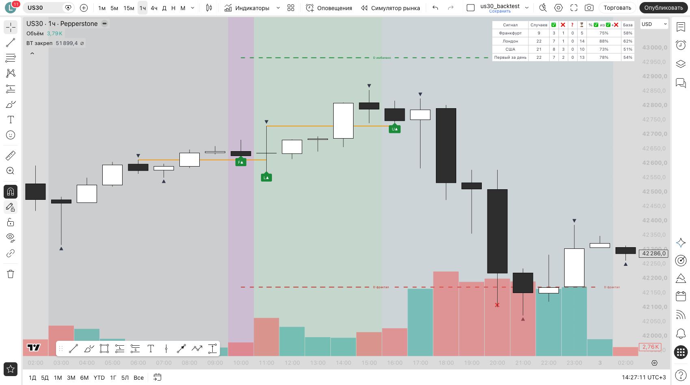

### 2025-01-03

- 12:00 Лондон — лонг за уровнем 42385.5 (Азия сегодня) → ⏳
- 18:00 США — лонг за уровнем 42461.9 (Лондон сегодня) → ⏳

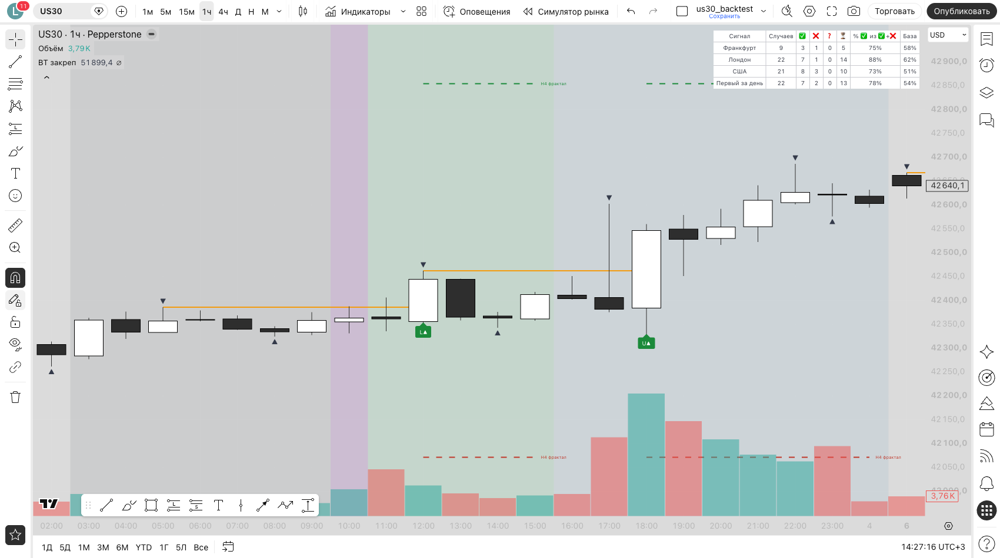

### 2025-01-06

- 11:00 Лондон — лонг за уровнем 42667.6 (вне сессий сегодня) → ⏳
- 16:00 США — лонг за уровнем 42719.7 (Лондон сегодня) → ✅ в 18:00

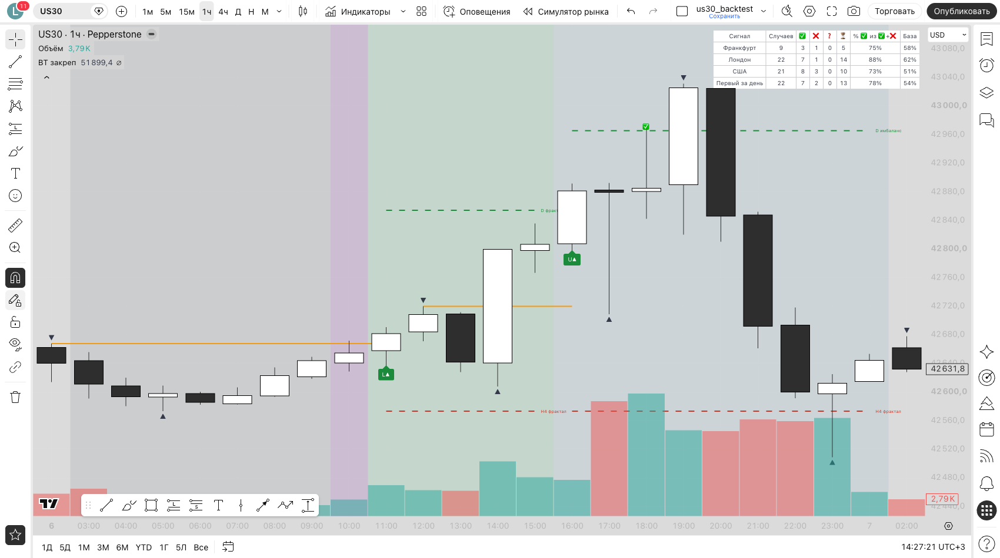

### 2025-01-07

- 11:00 Лондон — лонг за уровнем 42610.3 (Азия сегодня) → ⏳
- 16:00 США — лонг за уровнем 42669.2 (Лондон сегодня) → ❌ в 18:00

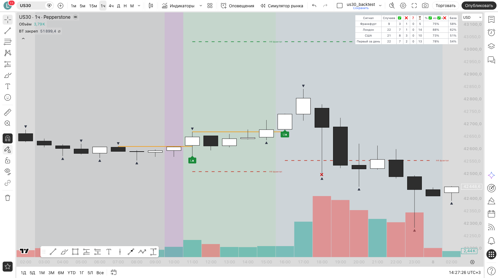

### 2025-01-08

- 12:00 Лондон — лонг за уровнем 42545.4 (Азия сегодня) → ⏳
- 16:00 США — шорт за уровнем 42471.5 (Франк сегодня) → ✅ в 17:00

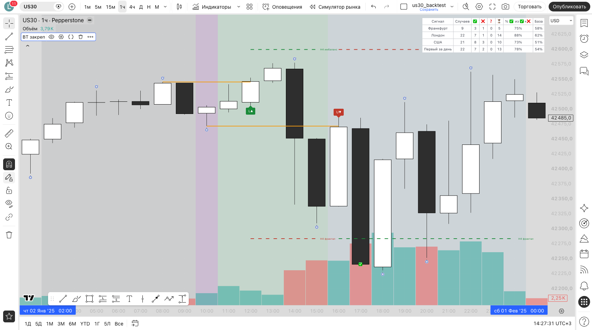

### 2025-01-09

- 10:00 Франкфурт — шорт за уровнем 42423.5 (Азия сегодня) → ⏳
- 11:00 Лондон — лонг за уровнем 42481.7 (Азия сегодня) → ⏳

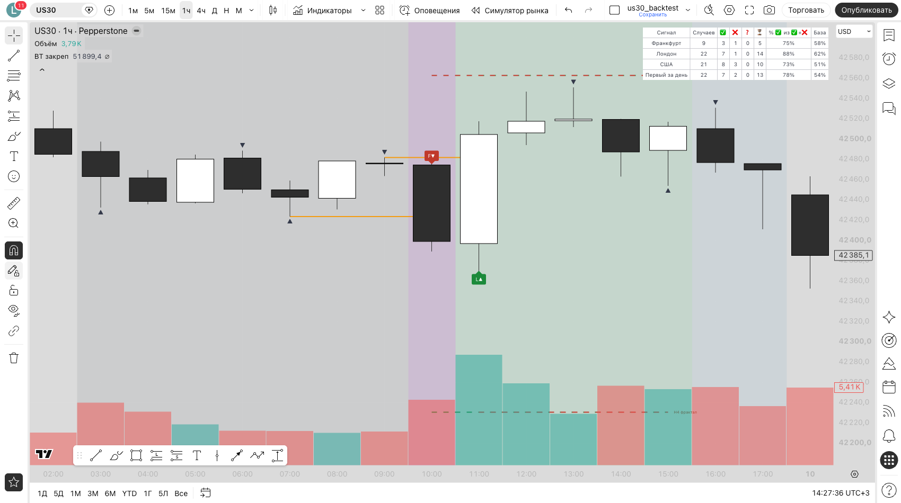

### 2025-01-10

- 10:00 Франкфурт — лонг за уровнем 42481.6 (Азия сегодня) → ✅ в 14:00
- 11:00 Лондон — лонг за уровнем 42481.6 (Азия сегодня) → ✅ в 14:00
- 16:00 США — шорт за уровнем 42407.0 (Лондон сегодня) → ✅ в 18:00

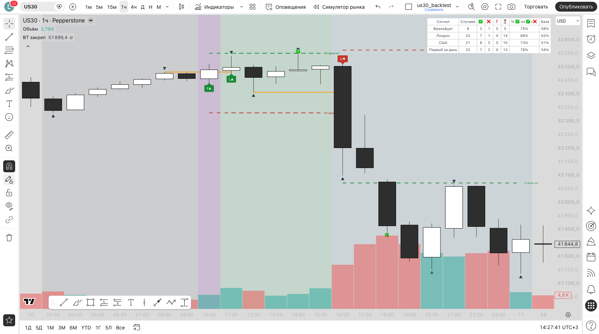

### 2025-01-13

- 11:00 Лондон — шорт за уровнем 41719.8 (Азия сегодня) → ✅ в 12:00
- 16:00 США — лонг за уровнем 41789.2 (Лондон сегодня) → ✅ в 18:00

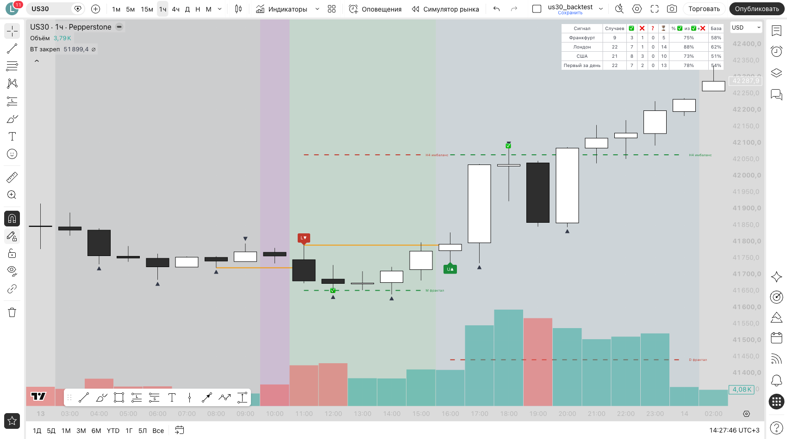

### 2025-01-14

- 11:00 Лондон — лонг за уровнем 42305.2 (Азия сегодня) → ⏳
- 19:00 США — шорт за уровнем 42209.3 (США сегодня) → ⏳

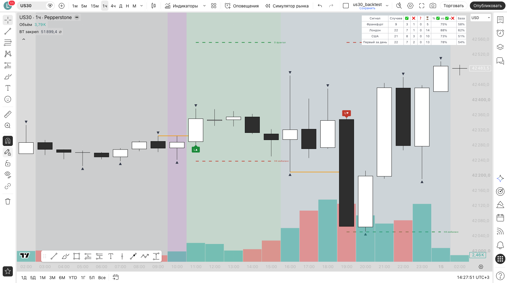

### 2025-01-15

- 13:00 Лондон — лонг за уровнем 42498.5 (Азия сегодня) → ✅ в 14:00
- 16:00 США — лонг за уровнем 42498.5 (Азия сегодня) → ⏳

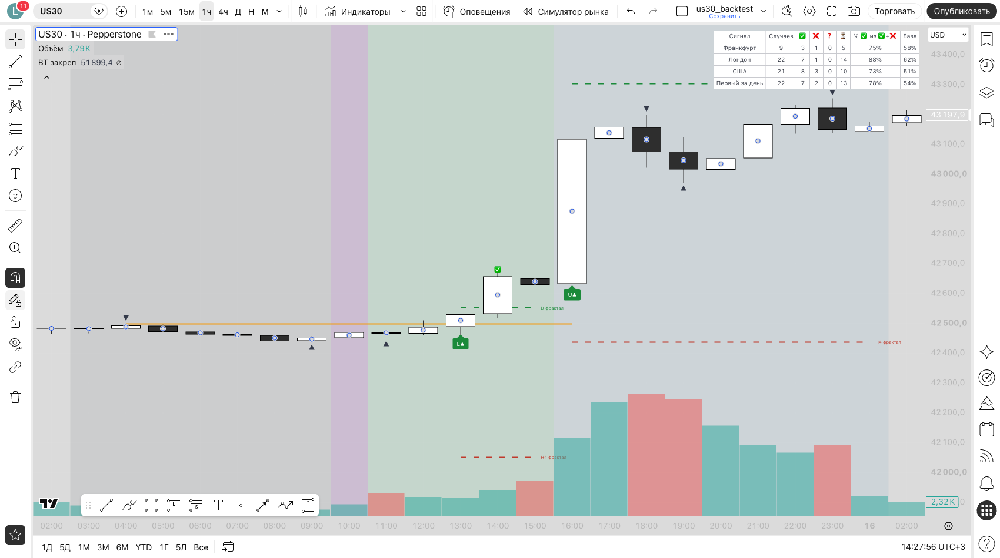

### 2025-01-16

- 10:00 Франкфурт — лонг за уровнем 43207.9 (Азия сегодня) → ⏳
- 11:00 Лондон — шорт за уровнем 43149.1 (Азия сегодня) → ⏳
- 16:00 США — шорт за уровнем 43027.8 (Лондон сегодня) → ⏳

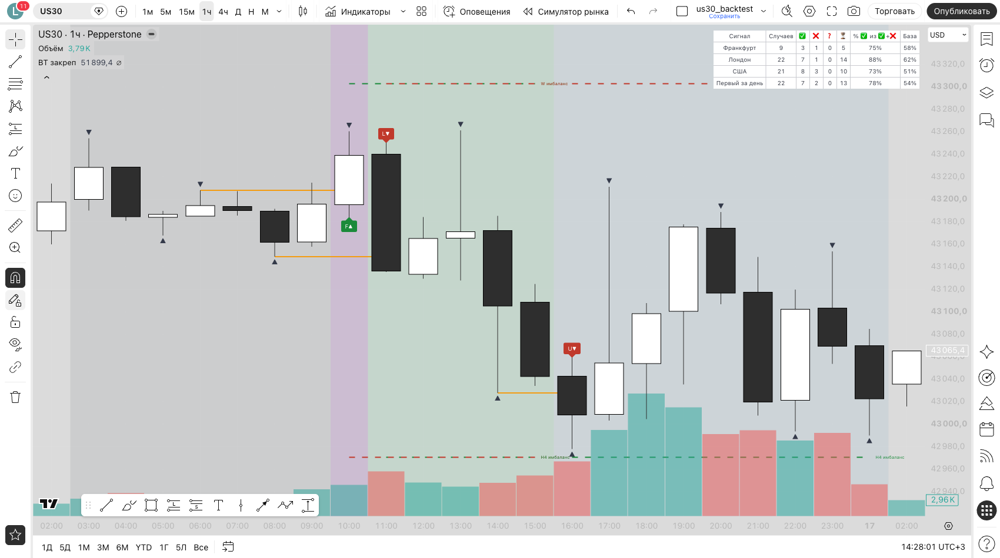

### 2025-01-17

- 11:00 Лондон — лонг за уровнем 43140.2 (Азия сегодня) → ⏳
- 16:00 США — лонг за уровнем 43251.6 (Лондон сегодня) → ⏳

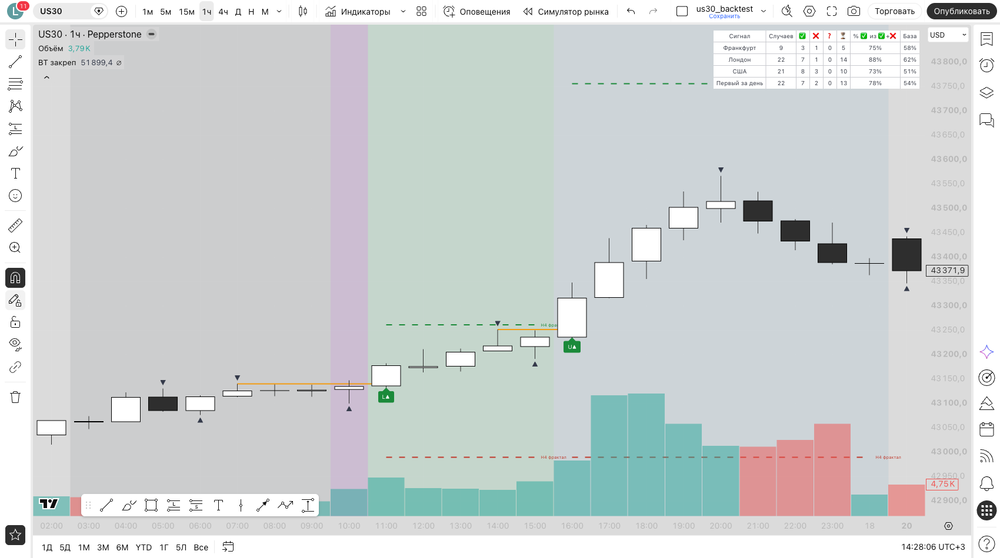

### 2025-01-20

- 10:00 Франкфурт — лонг за уровнем 43394.6 (Азия сегодня) → ⏳
- 11:00 Лондон — лонг за уровнем 43394.6 (Азия сегодня) → ⏳
- 16:00 США — лонг за уровнем 43469.0 (Лондон сегодня) → ⏳

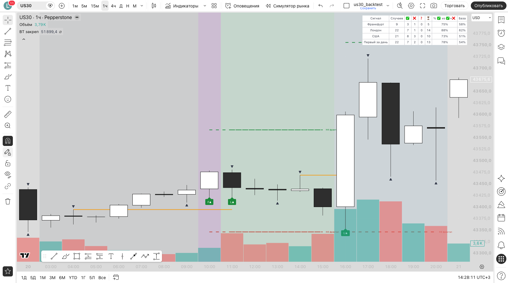

### 2025-01-21

- 12:00 Лондон — лонг за уровнем 43584.6 (Азия сегодня) → ⏳
- 17:00 США — лонг за уровнем 43648.7 (Лондон сегодня) → ✅ в 23:00

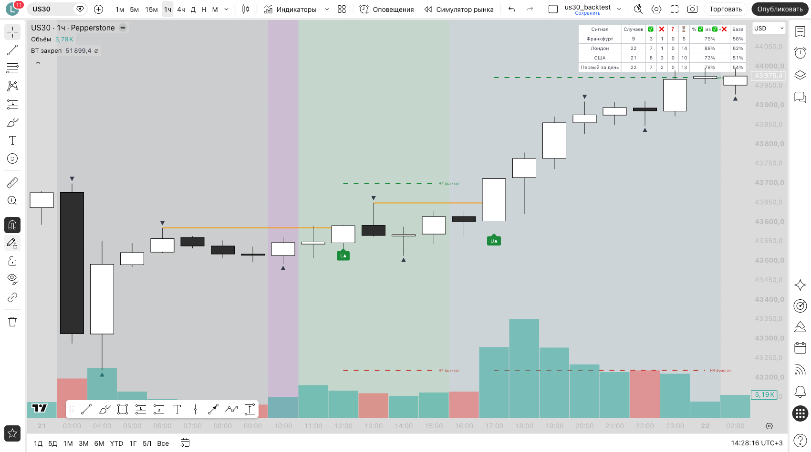

### 2025-01-22

- 10:00 Франкфурт — шорт за уровнем 43970.1 (Азия сегодня) → ❌ в 11:00
- 11:00 Лондон — лонг за уровнем 43996.9 (Азия сегодня) → ✅ в 14:00
- 16:00 США — лонг за уровнем 44053.0 (Лондон сегодня) → ⏳

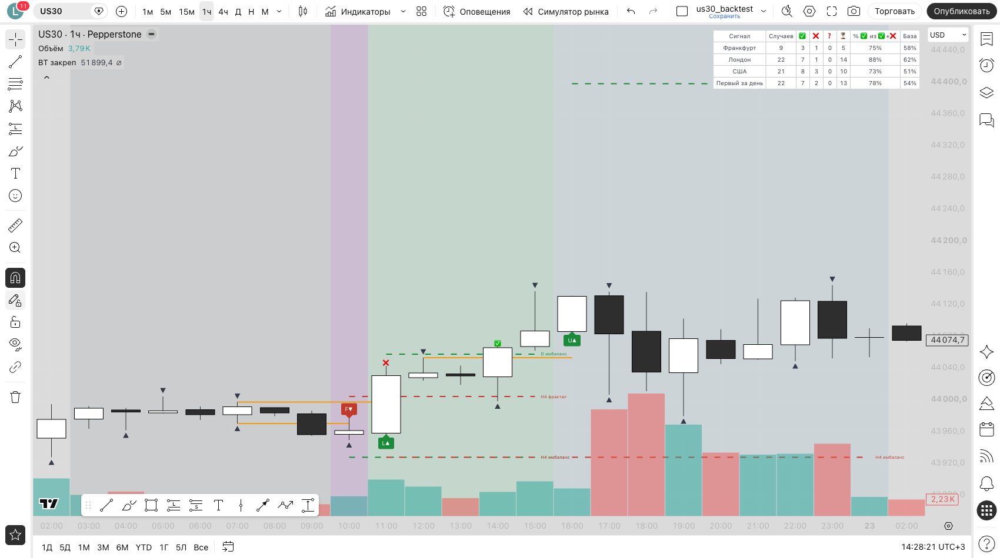

### 2025-01-23

- 11:00 Лондон — шорт за уровнем 44055.7 (Азия сегодня) → ❌ в 15:00
- 16:00 США — лонг за уровнем 44081.7 (Азия сегодня) → ✅ в 20:00

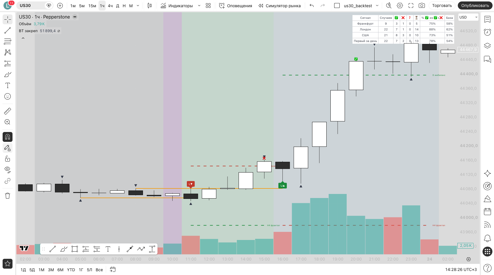

### 2025-01-24

- 12:00 Лондон — шорт за уровнем 44445.4 (Азия сегодня) → ✅ в 15:00
- 16:00 США — шорт за уровнем 44400.3 (Лондон сегодня) → ⏳

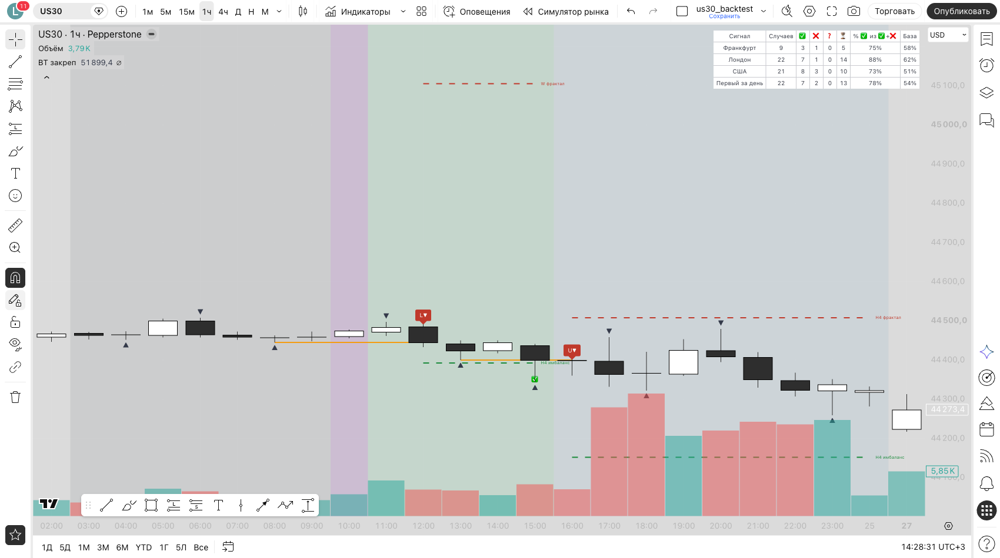

### 2025-01-27

- 10:00 Франкфурт — шорт за уровнем 44130.7 (Азия сегодня) → ✅ в 11:00
- 11:00 Лондон — шорт за уровнем 44130.7 (Азия сегодня) → ⏳
- 16:00 США — лонг за уровнем 44024.3 (Лондон сегодня) → ✅ в 17:00

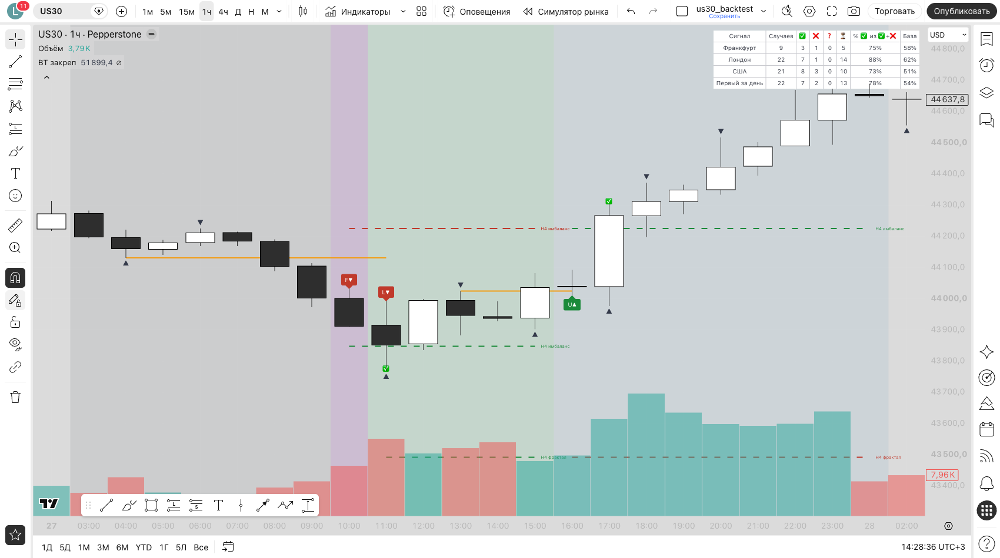

### 2025-01-28

- 11:00 Лондон — лонг за уровнем 44613.5 (Азия сегодня) → ✅ в 12:00
- 18:00 США — лонг за уровнем 44724.7 (Лондон сегодня) → ⏳

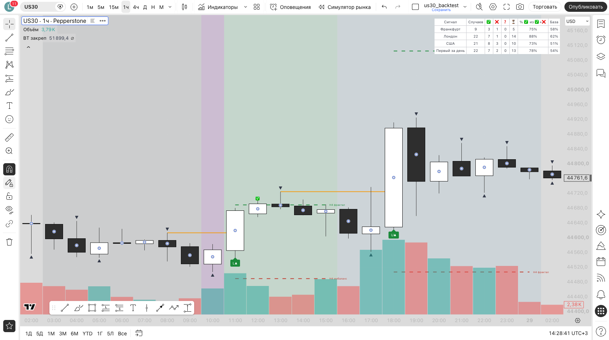

### 2025-01-29

- 11:00 Лондон — шорт за уровнем 44774.4 (Азия сегодня) → ⏳
- 17:00 США — лонг за уровнем 44823.5 (Лондон сегодня) → ⏳

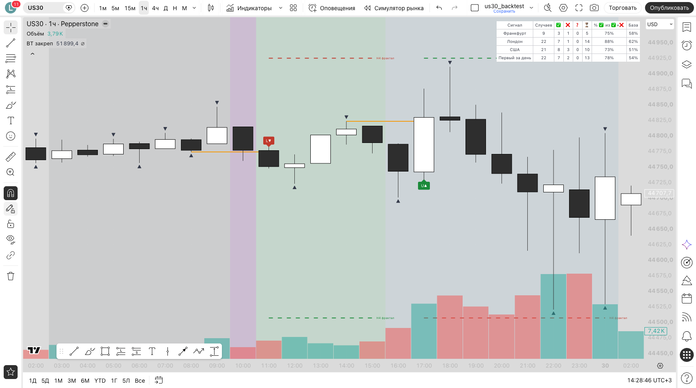

### 2025-01-30

- 10:00 Франкфурт — лонг за уровнем 44792.4 (Азия сегодня) → ⏳
- 11:00 Лондон — лонг за уровнем 44792.4 (Азия сегодня) → ⏳
- 16:00 США — шорт за уровнем 44740.9 (Азия сегодня) → ❌ в 21:00

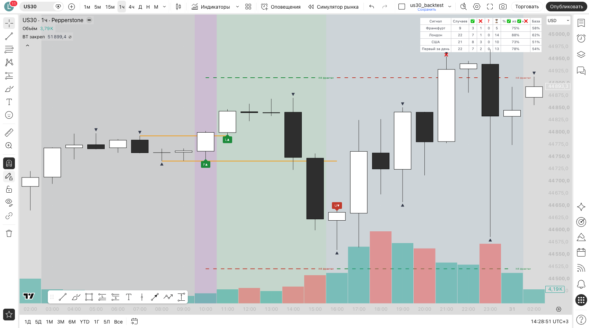

### 2025-01-31

- 10:00 Франкфурт — лонг за уровнем 44914.5 (Азия сегодня) → ✅ в 12:00
- 11:00 Лондон — лонг за уровнем 44914.5 (Азия сегодня) → ✅ в 12:00
- 17:00 США — шорт за уровнем 44873.0 (Азия сегодня) → ✅ в 21:00

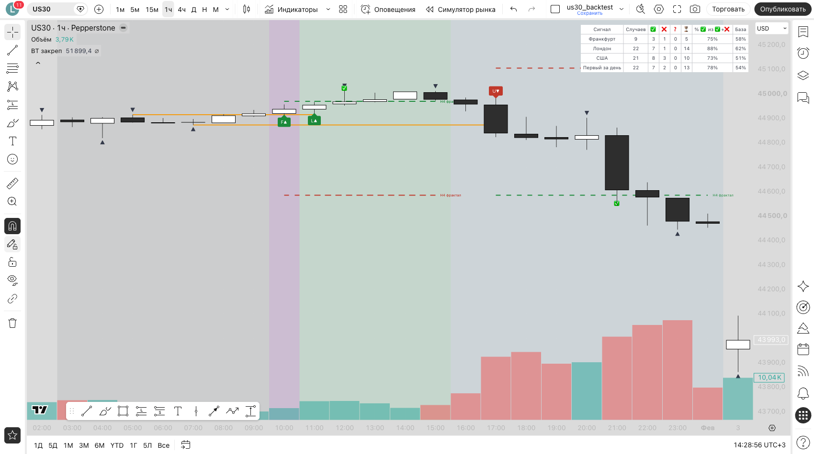

## Ограничения этого прогона

- Пилот на одном месяце — только проверка правил и вида отчёта.
- История H1 на тарифе TradingView Essential ≈ 10 000 свечей; для 2 января нет свечей предыдущего дня, поэтому фракталы «вчера» в этот день недоступны.
- Порядок касаний внутри одной часовой свечи не виден: такие случаи помечены ❓.
- Цели — только нетронутые на момент сигнала фракталы и имбалансы H4/D/W/M; задетая зона больше не цель.
